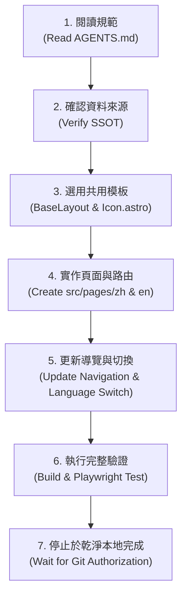

# AGENTS.md — Grand Library AI 協作與網頁擴充維護規範

> **適用對象**：所有參與維護、擴充、修復或建置 **Grand Library — CS & AI Knowledge Atlas** 的 AI 代理人與開發者。  
> **核心宗旨**：讓任何 AI 即使在沒有先前對話歷史的全新 Session 中，亦能精確理解專案架構、設計規範、唯一真理來源，並遵循標準流程安全擴充頁面，絕不破壞既有知識庫的正確性與 Git 歷史。

---

## 1. 專案目的與核心願景 (Project Purpose)

- **核心定位**：Grand Library 是「資訊工程與人工智慧雙語知識圖書館」（CS & AI Knowledge Atlas），堅持 **Research-grade content, reader-first experience**。內容有科研深度，視覺呈現則如專業科技教材，而非自動生成的 AI Dashboard。
- **目標讀者**：資訊工程與人工智慧領域之大學生、專題研究員，以及自主 AI 代理人（Autonomous Agents）。
- **知識庫與網站的關係**：
  - **知識庫（Repository Notes）是唯一真理來源（Single Source of Truth, SSOT）**。
  - **網站（Site）是知識庫的視覺化與互動呈現層（Presentation Layer）**。
  - 網站的責任是將原始 Markdown、LaTeX 數學式、SVG 架構圖、Obsidian WikiLinks 與拓樸依賴（DAG）以最高品質在瀏覽器中靜態渲染，不得擅自竄改、簡化、複製或分裂知識內容。

---

## 2. 目錄架構與責任分工 (Repository Structure)

本儲存庫遵循嚴格的關注點分離原則，各目錄之責任分工如下：

```
library/
├── AGENTS.md                          # [本文件] AI 協作、規範與擴充指南 (SSOT for Agents)
├── README.md                          # 繁體中文總覽與專案入口
├── README.en.md                       # 英文總覽
├── 00 圖書館總覽 (Library Index).md     # 知識庫總索引入口文件
├── 00_總覽與拓樸導覽/                   # 分館 00：總覽、第一性原理與拓樸圖
├── 01_數學與理論基石/                   # 分館 01：線性代數、機率統計、凸最佳化
├── 02_計算機系統與硬體架構/             # 分館 02：GPU 體系結構、Warp 對齊、記憶體階層
├── 03_機器學習與統計學習原理/           # 分館 03：資料偏差、領域漂移、懲罰幾何
├── 04_深度學習架構與神經機制/           # 分館 04：CNN 歸納偏置、Transformer、擴散模型
├── 05_計算機視覺與高維感測/             # 分館 05：前處理質心對齊、對極幾何、NeRF、3DGS
├── 06_自然語言處理與大語言模型/         # 分館 06：現代 LLM 架構、縮放定律、RAG/CAG
├── 07_強化學習與智慧代理人/             # 分館 07：LLM Agent 認知架構、雙進程神經代理
├── 08_AI系統工程與高效部署/             # 分館 08：模型校準、量化數學、低精度推論
├── 09_科研方法論與頂尖專題藍圖/         # 分館 09：MNIST 實證復盤、專題藍圖、文獻體系
├── en/                                # 英文對應版（目錄與檔名結構完全鏡像對稱）
│   ├── 00_overview/ ... 09_research_methodology/
│   └── README.md
├── assets/                            # 知識庫核心 SVG 架構圖與圖表資產
├── scripts/
│   ├── validate_library.py            # [核心守門員] 11 項知識完整性與 DAG 拓樸驗證器
│   └── library_rag.py                 # 知識檢索輔助工具
├── site/                              # [網站原始碼] Astro + TypeScript 靜態網站
│   ├── package.json                   # 網站依賴與建置腳本
│   ├── package-lock.json              # 鎖定依賴樹 (包含 playwright)
│   ├── astro.config.mjs               # Astro 配置（GitHub Pages Base Path: /library）
│   ├── src/
│   │   ├── layouts/                   # BaseLayout 共同版面 (含 SVG Favicon)
│   │   ├── components/                # Header, Footer, ArticleCard, Icon (SVG Line Icons)
│   │   ├── lib/                       # 知識庫解析器 (library.ts)、KaTeX、WikiLinks
│   │   ├── pages/                     # Astro 靜態頁面路由 (zh/, en/, index.astro)
│   │   └── styles/                    # 設計系統全域樣式與主題變數 (global.css)
│   ├── public/                        # 靜態圖標、資產、KaTeX 字型
│   ├── scripts/                       # verify-learning-paths.mjs, run-browser-tests.mjs
│   └── README.md                      # 網站架構與擴充指引
└── .github/workflows/
    ├── validate.yml                   # CI 知識庫完整性自動驗證
    └── deploy-pages.yml               # GitHub Pages 自動建置與部署
```

---

## 3. 設計系統規範 (Design System & Editorial UX)

為體現「國家級研究圖書館 / 學術殿堂」的穩重感與專業性，網站採用嚴謹的**深色學術研究風格（Dark Academic Research Library Theme）**：

### 3.1 語言與排版
- **繁體中文優先雙語介面**：介面預設為 Traditional Chinese（臺灣慣用語法，如「資訊工程」、「快取」、「向量」、「矩陣」），英文為次要版本。
- **字型家族**：
  - 中文主字型：`Noto Serif TC`, `Songti TC`, `Source Han Serif TW`, serif
  - 西文標題：`Cinzel`, `Playfair Display`, `Georgia`, serif
  - 內文與介面：`Inter`, system-ui, sans-serif
  - 程式碼字型：`JetBrains Mono`, `Fira Code`, monospace
  - 數學式：由 KaTeX 專用離線字型渲染

### 3.2 色彩哲學（Color Palette）
| 語意命名 | 色碼 / 描述 | 用途 |
| :--- | :--- | :--- |
| `bg-primary` | `#0b0f19` (極深群青藍黑) | 網站全域背景 |
| `bg-surface` | `#121826` (深海軍藍) | 卡片、導覽列、側邊欄背景 |
| `bg-elevated` | `#1a2234` (高階面板) | 浮動卡片、程式碼區塊、抽屜面板 |
| `text-primary` | `#f8fafc` (白銀灰) | 主要標題、核心閱讀內文 |
| `text-secondary` | `#94a3b8` (石板灰) | 次要敘述、詮釋資料標籤 |
| `text-muted` | `#64748b` (鉛灰) | 頁尾資訊、版權、時間戳記 |
| `accent-gold` | `#d4af37` / `#f59e0b` (古雅典金) | 圖書館徽章、高亮強調、選中狀態 |
| `accent-cyan` | `#38bdf8` (學術天藍) | 內部超連結、WikiLinks、數學常數 |
| `border-subtle` | `#1e293b` (深邃幽藍) | 分隔線、卡片邊框 |

### 3.3 UI 介面全面禁止使用 Emoji (UI No-Emoji Rule)
- **核心禁令**：網站 UI 介面（導覽列 Header、頁尾 Footer、分館卡片、標籤、按鈕、狀態徽章、搜尋列）**全面嚴格禁止使用 Emoji**（如 🏛️、🌐、🔍、📚、⚖️、⚡ 等）。
- **統一線條圖標系統**：所有 UI 圖標必須使用純 SVG Line Icon 元件 `src/components/Icon.astro`（包含 `atlas`, `compass`, `math`, `cpu`, `chart`, `network`, `camera`, `text`, `bot`, `settings`, `academic`, `globe`, `search`, `book-open`, `layers`, `shield-check`, `clock` 等）。
- 嚴禁依賴任何未被打包的外部圖標套件或網路 CDN 字型。

### 3.4 讀者第一閱讀版面 (Reader-First Editorial Layout)
- **第一屏研讀導引與閱讀入口 (Study Orientation & Action)**：文章頂部優先呈現篇名、核心研讀導引（Study Orientation / Context Brief）以及顯眼的「開始閱讀 (Start Reading)」入口按鈕（錨點平滑跳轉至 `#article-content`）。移除不精確、誤導性的技術文章「預估閱讀時間」。
- **漸進式揭露抽屜 (Progressive Disclosure Drawer)**：密集的技術規格（狀態、作者、嚴格 `YYYY-MM-DD` 撰寫維護日、目標讀者、數學基石、硬體對齊、104 條形式化系統合約）與前後依賴（Prerequisites / Successors），統一收納於 `<details class="metadata-drawer">` 中，讀者按需展開，第一屏維持專注。
- **單一 H1 語意純淨性 (Strict Single H1 Invariant)**：Reader 頁面嚴格維持僅有一個主要的 `<h1>`（即版面 Header 的篇名）；原始 Markdown 中的文件大標題 `# 標題` 由渲染管線自語意層消除，避免重複顯示或污染 TOC，其餘內文層級（H2、H3 等）則 100% 完整保留。
- **舒適閱讀欄寬與行高**：正文閱讀欄寬嚴格控制於 68–76 字元（`max-width: 760px`），行高 1.8，字級 1.05rem。
- **右側常駐目錄 (Sticky TOC)**：桌面端右側懸浮章節目錄，平滑捲動跳轉。
- **滾動防禦與零橫向溢出 (Zero Horizontal Scroll Overflow)**：程式碼區塊（`<pre>`）、表格（`<table>`）與 KaTeX 獨立顯示公式（`.katex-display-container`）均具備 `overflow-x: auto` 橫向滾動保護；全站桌面端（1440px）與手機端（390px）嚴格保證 `scrollWidth <= clientWidth`，Grid 容器必須搭配 `minmax(0, 1fr)` 與 `min-width: 0` 防止非預期撐破版面。

### 3.5 杜絕 AI 模板感與浮誇裝飾 (Anti-Decorative Bloat)
- 移除廉價 KPI 儀表板卡片、浮誇漸層或無實質價值的光暈動畫。
- 分館卡片、導讀卡片以讀者導向簡介與編號為主，避免千篇一律的模板色塊。

### 3.6 典籍簡介真實性與事實查核 (Content Fidelity & Fact-Checking)
- **內容忠實性**：首頁精選、分館目錄與各處展示卡片之文章代號、篇名與推薦理由，必須 100% 忠實對齊原始 Markdown 內容與 Frontmatter。
- **典型負面禁忌**：嚴禁憑空發明或張冠李戴。例如 `LIB-504` 之核心研究為「3D 視覺前沿：神經輻射場 (NeRF) 到 3D 高斯潑濺 (3DGS) 理論與可微分光柵化」，嚴禁誤植為「空間變換網路 (Spatial Transformer Networks, STN)」。

### 3.7 Content Density & Interface Clarity（內容密度與介面清晰度）

**Primary Principle**

Avoid unnecessary secondary labels and descriptions. Let the layout do the explaining.

**中文原則**

避免不必要的次要標籤與重複說明。優先透過版面結構、視覺層級、間距及元件關係傳達資訊，而不是增加文字。

**Mandatory Constraints**

1. Remove redundant labels, repeated metadata, decorative badges, and descriptions that merely restate headings.
2. Preserve clear action labels, navigation context, accessibility labels, and information necessary to predict what an interaction will do.
3. Preserve educational explanations, prerequisites, learning objectives, research evidence, and material warnings.
4. Do not sacrifice comprehension, accuracy, or accessibility to achieve lower word counts.
5. For learning pages, preserve the essential sequence: What am I learning? Why does it matter? What should I read next?
6. When a page is changed, verify that a first-time visitor can identify its purpose, primary action, and expected result without prior project knowledge.

**Acceptance Criterion**

The interface should be concise without becoming ambiguous. Removing words is not considered an improvement unless clarity and usability are preserved.

---

## 4. 命名、路由與搜尋規範 (Naming, Routing & Search)

### 4.1 核心文章 ID
- 所有 28 篇核心典籍皆擁有唯一的格式代號：`LIB-###`（例如 `LIB-000` 至 `LIB-906`）。
- 任何與文章相關之邏輯、資料索引與錨點，均以此 ID 作為 Canonical Key。

### 4.2 URL 結構對稱性
中文與英文版必須維持嚴格對稱的 URL 階層：
- **首頁**：中文 `/library/zh/`，英文 `/library/en/`
- **文章目錄 (Catalog)**：中文 `/library/zh/library/`，英文 `/library/en/library/`
- **文章閱讀器 (Reader)**：中文 `/library/zh/notes/lib-001/`，英文 `/library/en/notes/lib-001/`
- **學習路徑 (Paths)**：中文 `/library/zh/paths/`，英文 `/library/en/paths/`
- **關於 (About)**：中文 `/library/zh/about/`，英文 `/library/en/about/`

在任何閱讀頁面，點擊語言切換鈕必須原位跳轉至對應語言之相同文章 ID，嚴禁跳回首頁。

### 4.3 搜尋範圍誠實命名 (Search Scope Transparency)
- 圖書館目錄檢索僅針對篇名、編號、標籤與摘要進行即時篩選，介面與文案**統一標示為「文章搜尋」**，嚴格禁止誇大宣稱為「全文搜尋」。

---

## 5. 內容唯讀與渲染品質規範 (Content Integrity & Rendering QA)

1. **唯一內容來源**：根目錄下的 10 個分館資料夾與 `en/` 鏡像資料夾中的 Markdown 檔案，是知識庫不可動搖的唯一內容。
2. **禁止擅自改動**：
   - 嚴禁為了網頁排版方便而修改、刪減、重寫原始筆記內容。
   - 嚴禁在 `site/` 內部重複建立或複製 `LIB-###.md`。
3. **Markdown / LaTeX 編譯品質守則**：
   - **零星號洩漏 (Zero Leaked Asterisks)**：CommonMark 對 CJK 標點（如 `是**「...」**`）有左側界定限制。`src/lib/library.ts` 透過自研 `cjkStrong` 內聯語彙分析器擴充 Marked，確保中文粗體 100% 正確解析為 `<strong>`，內文嚴禁殘留裸露星號 `**`。
   - **單一主要 H1 守則 (Single Primary H1 Invariant)**：Reader 頁面僅保留 Header 之唯一文章大標題；Markdown 原始內文之第一行標題（`# 標題`）由渲染器在語意前置解析期消除，避免重複顯示或雙重標記；同時 Heading Renderer 針對 `depth === 1` 一律返回空字串並不計入目錄，保障全站 56 篇雙語典籍之 H1 唯一性。
   - **零雙重跳脫與實體外洩防護 (Zero Double Escaping)**：Marked 內建之 `parseInline` 會將 `&` 轉化為 `&amp;`、`'` 轉化為 `&#39;`。在生成目錄（TOC）與標題錨點 ID 前，必須精確還原為乾淨純文字（`plainText`），再由 Astro 範本進行安全單次跳脫，杜絕 `&amp;amp;` 或 `&amp;#39;` 等實體編碼洩漏在網頁可見文字中。
   - **KaTeX 嚴格原樣優先與容錯修復 (Verbatim-First & Robust KaTeX Invariant)**：數學渲染優先以原始 TeX 執行嚴格編譯（`throwOnError: true`），確保合法公式與轉義百分比符號 `\%` 100% 原樣輸出不被改寫；僅當原始 LaTeX 解析失敗時啟動安全回退修復：
     1. 自動轉義 `\text{...}` 內部未跳脫之底線（例如 `LIB-506` 的 `\text{[SAFETY_BOUND]}` 修正為 `\text{[SAFETY\_BOUND]}`）。
     2. 在偵測到未閉合大括號（`{` 多於 `}`）時，修復非標準下標括號閉合（例如 `LIB-802` 的 `_{j, :]^2]` 修正為 `_{j, :}^2]`）。全站 56 篇典籍達到 **0 個 `katex-error`**。
   - **標題語意完整性**：嚴禁在 Markdown 解析前使用正規表示式字串粗暴替換 `<h2/h3>`，此舉會引發 CommonMark 區塊層級判定失效。標題生成與錨點計算必須透過 Marked Custom Heading Renderer 完成。
   - **Obsidian WikiLinks**：支援雙括號語法（例如 `\[\[LIB-### ...\]\]` 與 `\[\[LIB-### ...|自訂標題\]\]`），自動轉換為站內對應頁面超連結（`.wikilink-badge`）。

---

## 6. 系統化學習路徑教學價值規範 (Learning Path Educational Value)

學習路徑是引導讀者循序漸進攻克領域知識的教學鷹架，必須嚴格落實以下規則：

1. **教學引導旅程 (Guided Learning Journey)**：
   - 每條路徑必須明確標註：
     - **適用對象 (Target Audience)**：明確指出適合大學生、專題生或高階研究員。
     - **預期學習收穫 (Learning Outcomes)**：條列完成研讀後的具體認知成果。
     - **起始推薦典籍 (Starting Volume)**：指明第一步的研讀心態與理論基石。
     - **步驟研讀目的 (Step Objective)**：說明每個節點在路徑中的角色。
     - **為何進入下一步 (Why Next Step)**：說明從前一節點過渡到下一節點的邏輯因果關係。
2. **數學級嚴謹的直接 DAG 拓樸邊 (Strict Direct DAG Edge Invariant)**：
   - 任何相鄰步驟 `A ──► B` 必須具備雙向宣告直接依賴：
     - 條件一：節點 B 的 Frontmatter `prerequisites` 明確宣告 A。
     - 條件二：節點 A 的 Frontmatter `successors` 明確宣告 B。
     - 條件三：節點 A 與 B 的 `LIB-###` ID 與雙語 Markdown 來源檔均真實存在。
   - 目前全館 3 條已驗證之直接路徑（共 23 節點、20 條直接拓樸邊）：
     - **路線 1 (Deep Learning)**: `LIB-000` ➔ `LIB-001` ➔ `LIB-101` ➔ `LIB-203` ➔ `LIB-405` ➔ `LIB-602` (5 邊)
     - **路線 2 (Computer Vision)**: `LIB-000` ➔ `LIB-001` ➔ `LIB-101` ➔ `LIB-203` ➔ `LIB-401` ➔ `LIB-501` ➔ `LIB-502` ➔ `LIB-504` ➔ `LIB-505` ➔ `LIB-506` (9 邊)
     - **路線 3 (AI Agents)**: `LIB-000` ➔ `LIB-001` ➔ `LIB-101` ➔ `LIB-203` ➔ `LIB-405` ➔ `LIB-703` ➔ `LIB-704` (6 邊)
3. **去除節點重複贅標 (Clean Learning Path Cards)**：
   - 移除每個節點卡片上重複出現的「直接拓樸邊 (Direct Edge) ... Verified Invariant」重複性徽章，改由頂部路徑長度標章與節點內部的「為何進入下一步 (Why Next Step)」自然展現因果關係，貫徹 Content Density & Interface Clarity 原則。
4. **全景地圖次要收合 (Collapsible Panorama Section)**：
   - 龐大的全館總覽 SVG 拓樸圖移至頁面底部之折疊手風琴區塊（`<details class="roadmap-accordion">`），且**預設折疊（不加 open 屬性）**，確保讀者進站時優先聚焦於教學步驟卡。

---

## 7. 新增頁面標準作業流程 (Page Extension Workflow)



### 步驟說明：
1. **閱讀規範**：重新檢驗本文件與設計系統規定，嚴格禁止 UI Emoji，遵循讀者第一版面與內容密度原則。
2. **確認資料來源與拓樸真實性**：確認新頁面所需資料來自現有 Markdown Frontmatter 或真實系統統計。若涉學習路徑，必經 `verifyLearningPathsStrictly()` 守門。
3. **選用共用模板與無 Emoji 組件**：使用 `src/layouts/BaseLayout.astro` 與 `src/components/Icon.astro`。
4. **實作頁面與路由**：在 `site/src/pages/zh/` 與 `site/src/pages/en/` 建立對稱的 `.astro` 頁面，保持路由對稱。
5. **更新導覽**：於 `Header.astro` 與 `Footer.astro` 加入新頁面連結，保持中英文選單一致。
6. **執行完整驗證**：在 `site/` 依序執行 `npm run verify-paths`、`npm run build`（含 Astro 編譯檢查）與 `npm test`（Playwright 瀏覽器實測與視覺截圖）。
7. **停止於乾淨本地完成**：回報真實證據（Log 與截圖），等待使用者 Git Delivery 授權。

### 7.1 AI 新增頁面具體示範 (AI Page Extension Demonstration)

為證明自主 AI 代理人能嚴格重複遵守本規範擴充網站，以「建立雙語專題進階導讀頁面」為例，AI 必須嚴格執行以下最小完整範例：

```astro
---
// site/src/pages/zh/example.astro (對應 en/example.astro 鏡像對稱)
import BaseLayout from '../../layouts/BaseLayout.astro';
import Icon from '../../components/Icon.astro';
import { loadLibraryArticles } from '../../lib/library';

const { zh } = loadLibraryArticles();
const base = import.meta.env.BASE_URL.replace(/\/$/, '');
const alternateUrl = `${base}/en/example/`;
---

<BaseLayout title="專題導讀示範 (Project Guide Demo)" lang="zh" alternateUrl={alternateUrl}>
  <div class="container py-8">
    <header class="page-header">
      <!-- 規範遵循：使用統一 SVG Line Icon，嚴格禁止 Emoji -->
      <div class="header-badge">
        <Icon name="academic" size={16} />
        <span>研究指引 (Research Guide)</span>
      </div>
      <h1 class="page-title">資訊工程專題研究方法論</h1>
      <p class="page-subtitle">遵循 AGENTS.md 規範之 AI 頁面擴充示範。</p>
    </header>

    <!-- 規範遵循：CSS Grid 必須搭配 minmax(0, 1fr) 風格軌道與 min-width: 0 防止橫向撐破版面 -->
    <div class="content-grid" style="display: grid; grid-template-columns: repeat(auto-fit, minmax(min(280px, 100%), 1fr)); gap: 1.5rem;">
      <div class="card" style="min-width: 0; background: var(--bg-surface); border: 1px solid var(--border-subtle); padding: 1.5rem; border-radius: 8px;">
        <h3>第一性原理實踐</h3>
        <p style="color: var(--text-secondary); font-size: 0.95rem;">所有數學推導與硬體對齊合約均來自原始知識庫真理來源。</p>
      </div>
    </div>
  </div>
</BaseLayout>
```

**AI 遵守檢核表 (Agent Compliance Checklist)**：
- [x] **SSOT 唯一真理**：內容自 `loadLibraryArticles()` 取得，絕不私自修改根目錄 Markdown 典籍。
- [x] **雙語對稱路由**：同步在 `zh/example.astro` 與 `en/example.astro` 建立對稱頁面，並在 `Header.astro` 中英文選單同步配置。
- [x] **零 Emoji 守則**：全面使用 `<Icon name="..." />`，UI 絕無任何 Emoji 字元。
- [x] **單一 H1 與防溢出**：整頁僅有一個 `<h1>`，Grid 容器具備 `minmax(0, 1fr)` 與 `min-width: 0`。
- [ ] **自動化回歸測試**：建置通過 65 頁＋新增雙語對稱頁之靜態產出，Playwright 端對端測試 100% 通過。

---

## 8. 驗證與測試規則 (Validation Rules)

在完成任何頁面新增或修改後，必須完成以下六大關卡驗證：

1. **原始知識庫驗證器**：
   ```bash
   python scripts/validate_library.py
   ```
   - 預期結果：於乾淨工作區（GitHub CI `validate.yml` 環境，不含 `site/node_modules`）回報 `ALL 11 INTEGRITY INVARIANTS PASSED`。若於本機存在 `site/node_modules` 時執行，舊版腳本會掃描第三方 `node_modules/**/*.md` 之已知限制，請以 CI 或隔離環境驗證為準。
2. **學習路徑直接拓樸邊自動化驗證**：
   ```bash
   cd site && npm run verify-paths
   ```
   - 預期結果：20 條直接拓樸邊 100% 通過驗證。
3. **Astro 靜態建置**：
   ```bash
   cd site && npm run build
   ```
   - 預期結果：65 頁靜態 HTML 產出完畢，0 錯誤。
4. **Markdown 渲染品質檢測**：
   - 抽驗 `LIB-405`、`LIB-001` 等重要篇目，確認內文無殘留 `**`，KaTeX 數學式 100% 靜態解析。
5. **端對端瀏覽器實測 (Playwright)**：
   ```bash
   cd site && npm test
   ```
   - 預期結果：47 項桌機（1440x900）與手機（390x844）測試全數 PASS（包含單一 H1、0 KaTeX 錯誤、0 雙重跳脫、0 橫向溢出、LIB-504 真實性）。
6. **六大視覺驗收截圖產出**：
   - `homepage-zh-desktop-1440.png`
   - `homepage-zh-mobile-390.png`
   - `paths-zh-desktop-1440.png`
   - `paths-zh-mobile-390.png`
   - `reader-lib405-zh-desktop-1440.png`
   - `reader-lib405-zh-mobile-390.png`

---

## 9. 安全守則與 Git 操作邊界 (Safety & Git Gate)

- **嚴禁破壞性操作**：
  - 禁止執行 `git reset --hard`、`git clean -fd`、`git checkout -f`。
  - 禁止執行未經授權的 Force Push 或覆蓋他人工作區。
- **嚴禁未授權修改原始筆記**：
  - 核心筆記（`00_*` 至 `09_*`、`en/*`）為嚴格唯讀。
  - 允許編輯範圍僅限：`AGENTS.md`、`site/**`、`.github/workflows/deploy-pages.yml`、`README.md` 的網站入口章節。
- **Git Delivery Gate**：
  - 本地開發完成後，**不得自行執行 `git add`、`git commit`、`git push` 或發起 PR**。
  - 必須將修改成果、測試日誌與驗證報告整理齊全，停留在乾淨的本地完成狀態，等待使用者親自審查並授權進一步操作。
- **真實性承諾**：
  - 所有測試狀態（`PASS` / `FAIL` / `PARTIAL` / `NOT_RUN`）必須基於終端機命令的真實輸出，嚴禁任何模擬造假。
