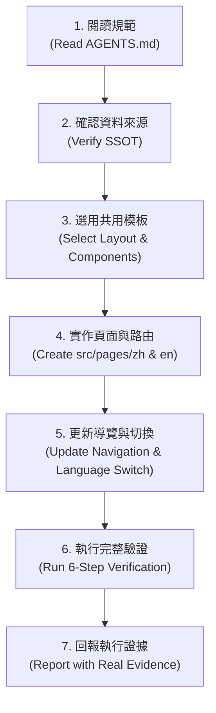

# AGENTS.md — Grand Library AI 協作與網頁擴充維護規範

> **適用對象**：所有參與維護、擴充、修復或建置 **Grand Library — CS & AI Knowledge Atlas** 的 AI 代理人與開發者。  
> **核心宗旨**：讓任何 AI 即使在沒有先前對話歷史的全新 Session 中，亦能精確理解專案架構、設計規範、唯一真理來源，並遵循標準流程安全擴充頁面，絕不破壞既有知識庫的正確性與 Git 歷史。

---

## 1. 專案目的與核心願景 (Project Purpose)

- **定位**：Grand Library 是「資訊工程與人工智慧雙語知識圖書館」（CS & AI Knowledge Atlas），兼具學術深度、數學形式化推導、GPU 體系結構對齊與生產級工程規範。
- **目標讀者**：資訊工程與人工智慧領域之大學生（如大二、大三學生）、專題研究新手、研究所研究員，以及自主 AI 代理人（Autonomous Agents）。
- **知識庫與網站的關係**：
  - **知識庫（Repository Notes）是唯一真理來源（Single Source of Truth, SSOT）**。
  - **網站（Site）是知識庫的視覺化與互動呈現層（Presentation Layer）**。
  - 網站的責任是將原始 Markdown、LaTeX 數學式、SVG 架構圖、Obsidian WikiLinks 與拓樸依賴（DAG）以最高品質在瀏覽器中靜態渲染，不得擅自竄改、簡化、複製或分裂知識內容。

---

## 2. 目錄架構與責任分工 (Repository Structure)

本儲存庫遵循嚴格的關注點分離原則，各目錄之責任分工如下：

```
library/
├── AGENTS.md                          # [本文件] AI 協作、規範與擴充指南 (SSOT for Agents)
├── README.md                          # 繁體中文總覽與專案入口
├── README.en.md                       # 英文總覽
├── 00 圖書館總覽 (Library Index).md     # 知識庫總索引入口文件
├── 00_總覽與拓樸導覽/                   # 分館 00：總覽、第一性原理與拓樸圖
├── 01_數學與理論基石/                   # 分館 01：線性代數、機率統計、凸最佳化
├── 02_計算機系統與硬體架構/             # 分館 02：GPU 體系結構、Warp 對齊、記憶體階層
├── 03_機器學習與統計學習原理/           # 分館 03：資料偏差、領域漂移、懲罰幾何
├── 04_深度學習架構與神經機制/           # 分館 04：CNN 歸納偏置、Transformer、擴散模型
├── 05_計算機視覺與高維感測/             # 分館 05：前處理質心對齊、對極幾何、NeRF、3DGS
├── 06_自然語言處理與大語言模型/         # 分館 06：現代 LLM 架構、縮放定律、RAG/CAG
├── 07_強化學習與智慧代理人/             # 分館 07：LLM Agent 認知架構、雙進程神經代理
├── 08_AI系統工程與高效部署/             # 分館 08：模型校準、量化數學、低精度推論
├── 09_科研方法論與頂尖專題藍圖/         # 分館 09：MNIST 實證復盤、專題藍圖、文獻體系
├── en/                                # 英文對應版（目錄與檔名結構完全鏡像對稱）
│   ├── 00_overview/ ... 09_research_methodology/
│   └── README.md
├── assets/                            # 知識庫核心 SVG 架構圖與圖表資產
├── scripts/
│   ├── validate_library.py            # [核心守門員] 11 項知識完整性與 DAG 拓樸驗證器
│   └── library_rag.py                 # 知識檢索輔助工具
├── site/                              # [網站原始碼] Astro + TypeScript 靜態網站
│   ├── package.json                   # 網站依賴與建置腳本
│   ├── astro.config.mjs               # Astro 配置（GitHub Pages Base Path: /library）
│   ├── src/
│   │   ├── layouts/                   # 共同版面 (BaseLayout, ArticleLayout)
│   │   ├── components/                # 導覽列、頁尾、卡片、搜尋列、語言切換鈕
│   │   ├── lib/                       # 知識庫解析器 (library.ts)、Markdown 處理工具
│   │   ├── pages/                     # Astro 靜態頁面路由 (zh/, en/, index.astro)
│   │   └── styles/                    # 設計系統全域樣式與主題變數
│   ├── public/                        # 靜態圖標與資產
│   └── README.md                      # 網站架構與擴充指引
└── .github/workflows/
    ├── validate.yml                   # CI 知識庫完整性自動驗證
    └── deploy-pages.yml               # GitHub Pages 自動建置與部署
```

---

## 3. 設計系統規範 (Design System)

為體現「國家級研究圖書館 / 學術殿堂」的穩重感與專業性，網站採用嚴謹的**深色學術研究風格（Dark Academic Research Library Theme）**：

### 3.1 語言與排版
- **繁體中文優先雙語介面**：介面預設為 Traditional Chinese（臺灣慣用語法，如「資訊工程」、「快取」、「向量」、「矩陣」），英文為次要版本。
- **字型家族**：
  - 中文主字型：`Noto Serif TC`, `Songti TC`, `Source Han Serif TW`, serif
  - 西文標題：`Cinzel`, `Playfair Display`, `Georgia`, serif
  - 內文與介面：`Inter`, system-ui, sans-serif
  - 程式碼字型：`JetBrains Mono`, `Fira Code`, monospace
  - 數學式：由 KaTeX 專用字型渲染

### 3.2 色彩哲學（Color Palette）
| 語意命名 | 色碼 / 描述 | 用途 |
| :--- | :--- | :--- |
| `bg-primary` | `#0b0f19` (極深群青藍黑) | 網站全域背景 |
| `bg-surface` | `#121826` (深海軍藍) | 卡片、導覽列、側邊欄背景 |
| `bg-elevated` | `#1c2438` (高階面板) | 浮動卡片、程式碼區塊頂部 |
| `text-primary` | `#f1f5f9` (白銀灰) | 主要標題、核心閱讀內文 |
| `text-secondary` | `#94a3b8` (石板灰) | 次要敘述、詮釋資料標籤 |
| `text-muted` | `#64748b` (鉛灰) | 頁尾資訊、版權、時間戳記 |
| `accent-gold` | `#d4af37` / `#f59e0b` (古雅典金) | 圖書館徽章、高亮強調、選中狀態 |
| `accent-cyan` | `#38bdf8` (學術天藍) | 內部超連結、WikiLinks、數學常數 |
| `border-subtle` | `#1e293b` (深邃幽藍) | 分隔線、卡片邊框 |

### 3.3 視覺組件規則
- **Cards**：具有細微邊框（`border-subtle`）、微光暈 hover 反應、明確之 Call-number 標籤與狀態徽章。
- **Navigation**：頂端固定 Header 提供圖書館標誌、主導覽（首頁、典籍目錄、學習路徑、關於）、即時搜尋快捷鍵與中/英文切換鈕。
- **Mobile Responsive**：全面支援桌機（Sidebar + Main + TOC）與手機（摺疊漢堡選單、觸控友善按鈕、自適應寬度表格與程式碼橫向捲軸）。
- **Anti-AI-Slop**：拒絕隨機花俏動畫、不必要的全螢幕裝飾、漸變刺眼霓虹特效或無意義的浮動元素。一切動態皆服務於閱讀與導覽。

---

## 4. 命名與路由規範 (Naming & Routing)

### 4.1 核心文章 ID
- 所有 28 篇核心典籍皆擁有唯一的格式代號：`LIB-###`（例如 `LIB-000` 至 `LIB-906`）。
- 任何與文章相關之邏輯、資料索引與錨點，均以此 ID 作為 Canonical Key。

### 4.2 URL 結構對稱性
中文與英文版必須維持嚴格對稱的 URL 階層：
- **首頁**：
  - 中文：`/library/zh/`（根目錄 `/library/` 自動導向或呈現預設繁中首頁）
  - 英文：`/library/en/`
- **文章目錄 (Catalog)**：
  - 中文：`/library/zh/library/`
  - 英文：`/library/en/library/`
- **文章閱讀器 (Reader)**：
  - 中文：`/library/zh/notes/lib-001/`
  - 英文：`/library/en/notes/lib-001/`
- **學習路徑 (Paths)**：
  - 中文：`/library/zh/paths/`
  - 英文：`/library/en/paths/`
- **關於 (About)**：
  - 中文：`/library/zh/about/`
  - 英文：`/library/en/about/`

在任何閱讀頁面，點擊語言切換鈕必須原位跳轉至對應語言之相同文章 ID，嚴禁跳回首頁。

---

## 5. 內容唯讀與真理來源原則 (Content Integrity Rules)

1. **唯一內容來源**：根目錄下的 10 個分館資料夾與 `en/` 鏡像資料夾中的 Markdown 檔案，是知識庫不可動搖的唯一內容。
2. **禁止擅自改動**：
   - 嚴禁為了網頁排版方便而修改、刪減、重寫原始筆記內容。
   - 嚴禁在 `site/` 內部重複建立或複製 `LIB-###.md`（這會破壞 `validate_library.py` 的重複檢驗）。
3. **動態解析 Markdown**：
   - 網站建置腳本直接讀取根目錄與 `en/` 下的 Markdown 來源檔，解析 Frontmatter 並渲染 HTML。
4. **Markdown 渲染強制支援**：
   - **LaTeX 數學公式**：支援行內 `$ ... $` 與獨立區塊 `$$ ... $$`，透過 KaTeX 編譯，不遺漏任何公式。
   - **Obsidian WikiLinks**：支援雙括號語法（例如 `\[\[LIB-### ...\]\]` 與 `\[\[LIB-### ...|自訂標題\]\]`），自動轉換為站內對應頁面超連結。
   - **本機資產與 SVG**：將 `assets/` 鏡像至靜態網站資產目錄，確保圖片連結正常運作。
   - **拓樸依賴展示**：每篇文章頂端必須呈現 `prerequisites`（前置依賴）與 `successors`（後續節點）可點擊清單。

---

## 6. 新增頁面標準作業流程 (Page Extension Workflow)

未來任何 AI 欲在網站中新增頁面（例如新增「知識拓樸雷達圖」、「作者誌」、「術語詞典」等），必須嚴格遵循以下七步流程：



### 步驟說明：
1. **閱讀規範**：重新檢驗本文件與設計系統規定，確認路由命名與語言規範。
2. **確認資料來源與拓樸真實性 (Strict DAG Invariant)**：
   - 確認新頁面所需資料來自現有 Markdown Frontmatter、AST 符號或真實系統統計。
   - **嚴禁造假虛構依賴關係**：任何學習路徑或導覽中的相鄰節點 `A ──► B`，必須具備數學嚴謹的有向直接依賴（Direct Directed Edge）：
     - 條件一：節點 B 的 Frontmatter `prerequisites` 明確宣告 A。
     - 條件二：節點 A 的 Frontmatter `successors` 明確宣告 B。
     - 條件三：節點 A 與 B 的 `LIB-###` ID 與雙語 Markdown 來源檔均真實存在。
     - 凡缺少任一條件，嚴禁標記為 DAG 依賴路徑，且自動化建置/測試必須直接 FAIL。
3. **選用共用模板**：使用 `src/layouts/BaseLayout.astro`，引入標準 Header、Footer 與主題樣式。
4. **實作頁面與路由**：在 `site/src/pages/zh/` 與 `site/src/pages/en/` 建立對稱的 `.astro` 頁面。
5. **更新導覽**：於 `Header.astro` 或相關索引元件中加入新頁面連結，保持中英文選單一致。
6. **執行驗證**：在 `site/` 執行 TypeCheck、Path Edge 驗證與 Build，並執行瀏覽器與連結測試。
7. **回報執行證據**：附上實際 Build Log、HTTP 狀態碼或 Playwright 截圖作為證據。

---

## 7. 驗證與測試規則 (Validation Rules)

在完成任何頁面新增或修改後，必須完成以下六大關卡驗證：

1. **原始知識庫驗證器**：
   ```bash
   python scripts/validate_library.py
   ```
   - 預期結果：`ALL 11 INTEGRITY INVARIANTS PASSED`（不可因網頁改動引入任何警告或錯誤）。
2. **學習路徑直接拓樸邊自動化驗證**：
   ```bash
   cd site && npm run verify-paths
   ```
   - 預期結果：路徑中所有相鄰節點（`A ──► B`）之 `prerequisites` 與 `successors` 對稱性檢查全部 PASS，0 違規。
3. **Astro 靜態建置**：
   ```bash
   cd site && npm run build
   ```
   - 預期結果：零 Error，全數 56 篇核心文章與所有系統頁面靜態 HTML 產出完畢。
4. **路由與 Base Path 檢查**：
   - 確認 GitHub Pages 設定之 `base: '/library'` 正確套用於所有超連結、CSS、JS 與 SVG 圖檔路徑。
5. **雙語切換與 WikiLinks 連通性**：
   - 抽驗至少 5 篇重要典籍之雙語切換按鈕，確認能正確原位轉換且不發生 404。
   - 確認內文 WikiLinks 轉換成正確的 `/library/zh/notes/lib-###/` 格式。
6. **桌機與行動版瀏覽器端實測**：
   - 使用 Playwright 執行真實無頭瀏覽器測試（`npm test`），檢驗 DOM 元素渲染、LaTeX 公式可見性及響應式版面，絕不憑空宣稱 PASS。

---

## 8. 安全守則與 Git 操作邊界 (Safety & Git Gate)

- **嚴禁破壞性操作**：
  - 禁止執行 `git reset --hard`、`git clean -fd`、`git checkout -f`。
  - 禁止執行未經授權的 Force Push 或覆蓋他人工作區。
- **嚴禁未授權修改原始筆記**：
  - 核心筆記（`00_*` 至 `09_*`、`en/*`）為嚴格唯讀。
  - 允許編輯範圍僅限：`AGENTS.md`、`site/**`、`.github/workflows/deploy-pages.yml`、`README.md` 的網站入口章節。
- **Git Delivery Gate**：
  - 本地開發完成後，**不得自行執行 `git add`、`git commit`、`git push` 或發起 PR**。
  - 必須將修改成果、測試日誌與驗證報告整理齊全，停留在乾淨的本地完成狀態，等待使用者親自審查並授權進一步操作。
- **真實性承諾**：
  - 所有測試狀態（`PASS` / `FAIL` / `PARTIAL` / `NOT_RUN`）必須基於終端機命令的真實輸出，嚴禁任何模擬造假。
