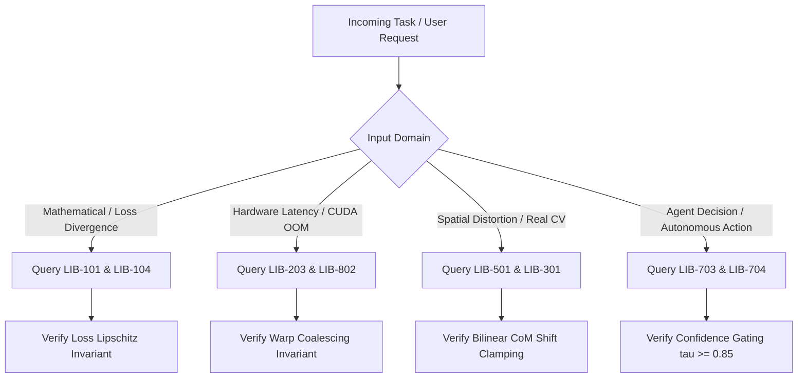

> Language / 語言: [🇹🇼 繁體中文](../../00_%E7%B8%BD%E8%A6%BD%E8%88%87%E6%8B%93%E6%A8%B8%E5%B0%8E%E8%A6%BD/LIB-000%20%E5%9C%96%E6%9B%B8%E9%A4%A8%E7%B8%BD%E8%A6%BD%E8%88%87%E6%8B%93%E6%A8%B8%E5%B0%8E%E8%A6%BD%E7%B3%BB%E7%B5%B1%20%28Grand%20Library%20Index%20&%20Navigator%29.md) | 🇺🇸 **English**

# Computer Science & Deep Learning Notes: Master Topological Navigator

## 1. Mathematical Formalization of the Knowledge DAG

The knowledge base is formalized as a finite, directed, acyclic graph:
$$\mathcal{G} = (\mathcal{V}, \mathcal{E}, \mathcal{A})$$
where:
- $\mathcal{V} = \{v_1, v_2, \dots, v_{28}\}$ is the set of 28 canonical academic volumes.
- $\mathcal{E} \subset \mathcal{V} \times \mathcal{V}$ is the set of directed dependency edges representing prerequisite orderings. If $(u, v) \in \mathcal{E}$, volume $u$ MUST be ingested and verified prior to volume $v$.
- $\mathcal{A}: \mathcal{V} \to 2^{\mathcal{I}}$ maps each node to a set of formal invariant rules $\mathcal{I} = \{\text{RULE-000-01}, \dots, \text{RULE-906-03}\}$ ($|\mathcal{I}| = 100$).

### Topological Sort & Execution Order
Because $\mathcal{G}$ contains no directed cycles ($\nexists \text{ path } u \rightsquigarrow u$), there exists at least one linear topological ordering $\tau: \mathcal{V} \to \{1, \dots, |\mathcal{V}|\}$ satisfying:
$$(u, v) \in \mathcal{E} \implies \tau(u) < \tau(v)$$

The canonical 3-tier linear ingestion schedule for autonomous agents is:
1. **Tier 1: Core Mathematical & Hardware Primitives**:
   $$\text{LIB-000} \to \text{LIB-001} \to \text{LIB-101} \to \text{LIB-102} \to \text{LIB-104} \to \text{LIB-203}$$
2. **Tier 2: Perception, Spatial Biases, Architectures & Systems**:
   $$\text{LIB-301} \to \text{LIB-401} \to \text{LIB-801} \to \text{LIB-405} \to \text{LIB-501} \to \text{LIB-502} \to \text{LIB-406} \to \text{LIB-602} \to \text{LIB-603} \to \text{LIB-504} \to \text{LIB-407} \to \text{LIB-703} \to \text{LIB-802} \to \text{LIB-505} \to \text{LIB-408} \to \text{LIB-704} \to \text{LIB-506}$$
3. **Tier 3: Empirical Systems & Capstone Research**:
   $$\text{LIB-901} \to \text{LIB-903} \to \text{LIB-904} \to \text{LIB-905} \to \text{LIB-906}$$

---

## 2. Defensible Status Taxonomy

To guarantee academic reliability and prevent decorative claims of verification, the library adheres to a strict 5-stage status taxonomy:
1. `draft`: Preliminary note or literature compilation under active synthesis; not yet peer-reviewed internally.
2. `reviewed`: Conceptually organized, internally reviewed for pedagogical and logical flow, with dependency topology verified.
3. `source-verified`: Mathematical derivations, definitions, and empirical figures have been audited directly against peer-reviewed primary literature (CVPR, ICCV, NeurIPS, ICML, ICLR, MLSys, TPAMI) or official specifications; no local empirical benchmark reproduction claimed.
4. `experiment-verified`: Code implementations, algorithmic pipelines, or numerical thresholds have been validated locally via reproducible automated test suites.
5. `production-validated`: System architecture deployed in live production with continuous telemetry and observed empirical stability.

---

## 3. Evidence Provenance Conventions

Every numerical metric, performance threshold, and scientific assertion in this library must carry explicit provenance classification:
- `[FACT]`: Established mathematical theorem, definition, or physical law.
- `[DERIVATION]`: Formal closed-form algebraic derivation from established axioms.
- `[LITERATURE_RESULT]`: Benchmark or empirical metric directly cited from peer-reviewed literature with explicit venue, authors, and conditions.
- `[EMPIRICAL_RESULT]`: Value directly measured locally via executable code in this repository.
- `[HEURISTIC]`: Practical rule of thumb or engineering guideline; not an analytic mathematical law.
- `[DESIGN_DECISION]`: Deliberate engineering choice selected among trade-offs.
- `[TARGET]`: Desired engineering or research performance goal to be validated in future experiments.
- `[SAFETY_BOUND]`: Defensive programming clamp or runtime guardrail.
- `[HYPOTHESIS]`: Theoretical conjecture or research proposition awaiting ablation testing.
- `[OPEN_QUESTION]`: Unresolved problem in literature or production systems.

---

## 4. Classification Taxonomy & Wing Mappings

The library indexes volumes into 10 specialized functional wings based on the ACM Computing Classification System (CCS 2012) and Dewey Decimal principles:

| Call Number Range | Wing Name | Focus Domain | Flagship Volumes & Key Invariants |
| :--- | :--- | :--- | :--- |
| **LIB-000 ~ 099** | **00 Overview & Protocols** | DAG Navigator & First Principles | [[LIB-000 Grand Library Index & Navigator (Agent EN)]], [[LIB-001 Deep Learning First Principles (Agent EN)]] |
| **LIB-100 ~ 199** | **01 Mathematical Foundations** | Linear Algebra, SVD, Probability, Info Theory, ELBO & Optimization | [[LIB-101 Linear Algebra & High-Dimensional Geometry (Agent EN)]], [[LIB-102 Probability, Information Theory & Variational Inference (Agent EN)]], [[LIB-104 Convex Optimization & Gradient Descent (Agent EN)]] |
| **LIB-200 ~ 299** | **02 Computer Systems & Hardware** | Memory Hierarchy & Microarchitecture | [[LIB-203 Computer Architecture & Hardware-Aware Deep Learning (Agent EN)]] |
| **LIB-300 ~ 399** | **03 Machine Learning Principles** | Covariate Shift & Spatial Penalties | [[LIB-301 Dataset Bias, Domain Shift & Spatial Penalties (Agent EN)]] |
| **LIB-400 ~ 499** | **04 Deep Learning Architectures** | CNNs, Transformers, Flow Matching, Instruction Editing & Harmonization | [[LIB-401 DNN Spatial Limits & CNN Inductive Bias (Agent EN)]], [[LIB-405 Attention Mechanism & Transformer Revolution (Agent EN)]], [[LIB-406 Generative Frontiers - SDE Diffusion to Flow Matching (Agent EN)]], [[LIB-407 Fine-Grained Instruction Image Editing & Cross-Attention Preservation (Agent EN)]], [[LIB-408 Context-Aware Object Generation, Illumination Estimation & Image Compositing (Agent EN)]] |
| **LIB-500 ~ 599** | **05 Computer Vision & Sensing** | Centering Moments, Projective/Epipolar Geometry, SfM, 3DGS Splatting, Semantic Retrieval & Spatial QA | [[LIB-501 CV Preprocessing & Center of Mass Alignment (Agent EN)]], [[LIB-502 Camera Projective Geometry, Epipolar Geometry & Structure-from-Motion (Agent EN)]], [[LIB-504 3D Gaussian Splatting Theory & Rasterization (Agent EN)]], [[LIB-505 Open-Vocabulary 3D Gaussian Splatting & Semantic Retrieval (Agent EN)]], [[LIB-506 LLM-Grounded 3D Scene QA, Hierarchical Scene Graphs & Embodied Navigation (Agent EN)]] |
| **LIB-600 ~ 699** | **06 NLP & Large Language Models** | Scaling Laws, Architecture, MoE, Dense Retrieval, RAG & CAG | [[LIB-602 Modern LLM Architecture & Scaling Laws (Agent EN)]], [[LIB-603 Dense Retrieval, RAG & Cache-Augmented Generation Architecture (Agent EN)]] |
| **LIB-700 ~ 799** | **07 RL & Intelligent Agents** | ReAct, Agentic Design Patterns, MCP/A2A & Dual-Process Cognition | [[LIB-703 LLM Agent Cognitive Architecture & Protocols (Agent EN)]], [[LIB-704 Dual-Process Neural Agent S1-Jev & Reflex CUA-S1 (Agent EN)]] |
| **LIB-800 ~ 899** | **08 Systems & Deployment** | Model Calibration & Quantization | [[LIB-801 Model Calibration & Uncertainty Estimation (Agent EN)]], [[LIB-802 Quantization Mathematics & Low-Precision Inference (Agent EN)]] |
| **LIB-900 ~ 999** | **09 Research Methodology** | Capstone Post-Mortem, Literature Synthesis, Five Frontier Blueprints & Conversational Epistemic Revision | [[LIB-901 Classic Project Post-Mortem - Production MNIST (Agent EN)]], [[LIB-903 Capstone Blueprint & Academic Research Evolution (Agent EN)]], [[LIB-904 Academic Research Corpus & Literature Synthesis (Agent EN)]], [[LIB-905 Frontier Vision & Multimodal Capstone Blueprints (Agent EN)]], [[LIB-906 LLM Conversational Epistemic Revision (Agent EN)]] |

---

## 5. Agent Protocol & Decision Invariants



### [RULE-000-01] Topological Dependency Invariant
- **Contract Level**: `CRITICAL_INVARIANT`
- **Specification**: Autonomous agents and researchers MUST NOT adopt, modify, or extend a library node without resolving and verifying its upstream DAG `prerequisites` (e.g., consulting `LIB-101` & `LIB-203` prior to modifying Attention kernels, or `LIB-501` & `LIB-301` prior to vision pipeline engineering).
- **Enforcement**: Automated topological sort verification via `scripts/validate_library.py`.

### [RULE-000-02] Multi-Perspective Content & Reproducibility Invariant
- **Contract Level**: `CRITICAL_INVARIANT`
- **Specification**: Every core volume addition or revision MUST integrate four orthogonal dimensions: (1) physical & geometric intuition, (2) closed-form mathematical derivations, (3) hardware microarchitecture alignment (memory hierarchy, Warp scheduling, cache locality), and (4) reproducible executable code with explicit tensor shape annotations and boundary assertions.

### [RULE-000-03] Peer-Reviewed Citation Invariant
- **Contract Level**: `CRITICAL_INVARIANT`
- **Specification**: All theoretical claims and algorithmic benchmarks MUST cite primary peer-reviewed literature (top-tier conferences: NeurIPS, ICML, ICLR, CVPR, ICCV, ECCV, SIGGRAPH, MLSys, SOSP, OSDI; journals: IEEE TPAMI, IEEE TIT, ACM TOG, CACM, Nature, Science, SIAM; or canonical monographs: Strang, Boyd, Nesterov, Vapnik, LeCun, Hennessy & Patterson) with authors, year, venue, and DOI/arXiv identifier. Secondary unreviewed blog sources are strictly prohibited.

### [RULE-000-04] Bidirectional Linkage & Graph Integrity Invariant
- **Contract Level**: `CRITICAL_INVARIANT`
- **Specification**: All cross-volume references MUST use native Obsidian bidirectional Wikilinks and symmetric YAML `prerequisites`/`successors` edges. The repository MUST maintain 0 broken internal links and 0 orphan nodes, verified via `scripts/validate_library.py`:
```python
def verify_library_integrity(dag_graph: dict):
    for node, prereqs in dag_graph.items():
        for p in prereqs:
            assert p in dag_graph, f"Broken link alert: dependency {p} of node {node} does not exist!"
```

---

## 6. Canonical Standards & References

1. **Association for Computing Machinery (ACM)** (2012 / Updated 2024). *The 2012 ACM Computing Classification System (CCS)*. ACM Official Nomenclature.
2. **Joint Task Force on Computing Curricula** (2023). *Computer Science Curricula 2023 (CS2023)*. IEEE Computer Society & ACM.
3. **OCLC** (2019). *Dewey Decimal Classification (DDC), 23rd Edition*. 004–006 Data Processing & Computer Science.
